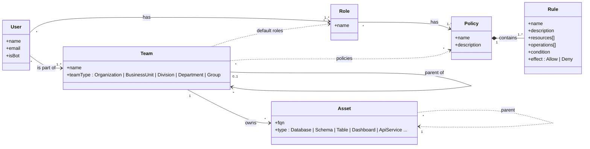

# CONCETTI

### UTENTE / USER 

Utente del sistema

- Ha uno o più ruoli assegnati: il ruolo determina cosa l'utente può fare
- Appartiene a uno o più team: il team di appartenenza determina a quali risorse l'utente ha accesso

### RUOLO / ROLE 

Un ruolo è un insieme predefinito di politiche (policy) che corrispondono a una determinata funzione lavorativa

Il ruolo attribuito ad un utente determina cosa l'utente può fare

**RUOLI DEFINITI**
- Viewer: utente di sola visualizzazione 
- Dev: data engineer / data analyst
- Source Admin: data lead
- Metadata Admin: data steward / catalog manager
- Admin: amministratore


### POLITICA / POLICY

Una policy è un insieme denominato di regole. 
Quando accedi a una risorsa in OpenMetadata, il sistema verifica tutte le regole presenti in tutte le policy applicabili al tuo account e decide se consentire o negare l'azione.

### REGOLA / RULE

Una regola in una policy è l'elemento costitutivo dell'autorizzazione.
Contiene i seguenti attributi:
- **Nome**: un nome univoco per definire la regola. 
- **Descrizione**: descrizione della regola. 
- **Risorse**: elenco delle risorse a cui si applica questa regola. Un amministratore può selezionare una risorsa specifica da applicare a tutte le risorse. 
- **Operazioni**: elenco delle operazioni a cui si applica questa regola. Un amministratore può selezionare un'operazione specifica da applicare a tutte le operazioni. 
- **Condizione**: espressioni scritte utilizzando funzioni di policy che valutano vero o falso. 
- **Effetto**: nega o consente l'operazione.

### GRUPPO / TEAM

Un team è un'unità organizzativa utilizzata per raggruppare gli utenti e controllare l'accesso alle risorse dati. 
I team supportano una struttura gerarchica che rispecchia la struttura della organizzazione

![[Pasted image 20261110120323.png]]

Ai team sono associati gli utenti (ognuno con il suo ruolo specifico)
I team sono gli owner degli asset: gli utenti appartenenti al team hanno accesso agli asset del team e possono operare su questi secondo le policy del loro ruolo 

### RISORSA / ASSET

Sono di vario tipo 
- Database
- Dashboard
- API services
- ...


### Roles Based Access Controls (RBAC) Search

Per impostazione predefinita, ogni utente può cercare e trovare qualsiasi risorsa dati in OpenMetadata, indipendentemente dal fatto che disponga o meno delle autorizzazioni per accedervi. 
Se si desidera che i risultati della ricerca riflettano le autorizzazioni di ciascun utente, attivare la ricerca RBAC. 
In questo modo, la ricerca mostrerà solo le risorse che le policy dell'utente gli consentono di visualizzare.
Gli utenti non possono trovare o visualizzare le risorse a cui non sono autorizzati ad accedere, nemmeno tramite la funzione di ricerca.


# OBIETTIVO

Rendere il sistema di autorizzazione di OMD più restrittivo in modo da 
- limitare la visibilità degli asset a determinati ambiti
- limitare le operazioni possibili sugli asset in base al ruolo dell'utente (es: utente di visualizzazione e utente di gestione)

OMD ha regole di autorizzazione molto libere.

![[organizationPolicy.png]]

Esiste una policy a livello Organization (**OrganizationPolicy**) composta da tre rules che permette le seguenti operazioni:
- **OrganizationPolicy-ViewAll-Rule**: tutti gli utenti hanno diritti di visualizzazione su tutti gli asset 
- **OrganizationPolicy-Owner-Rule**: tutti gli utenti che hanno diritti di ownership su un asset possono fare qualunque operazione
- **OrganizationPolicy-NoOwner-Rule:** tutti gli utenti hanno il diritto di attribuire una ownership su entità senza ownership

Per restringere il meccanismo è necessario:
- Rimuovere la rule **OrganizationPolicy-ViewAll-Rule** e aggiungere una rule **OrganizationPolicy-TeamViewAll-Rule** in modo tale da permettere la sola visualizzazione di asset di proprietà del team di cui fa parte l'utente 
- Rimuovere le rule **OrganizationPolicy-Owner-Rule** e **OrganizationPolicy-NoOwner-Rule** e definire le regole relative alle operazioni autorizzate su un singolo ruolo (es: dev o admin)

	
**Limitare la visibilità**

Il meccanismo adottato per limitare la visibilità delle risorse avviene attraverso la ownership degli asset da parte dei team. 
In questo modo ogni utente vede solo gli asset di proprietà dei team di cui fa parte.
Questo viene implementato dalla policy **OrganizationPolicy-TeamViewAll-Rule**

```
OrganizationPolicy-TeamViewAll-Rule

Description: Regola per la visibilità degli asset agli utenti del team
Resources: All
Operations: ViewAll
Effect: Allow
Condition: isOwner()
```

NOTA: sostituito matchTem() con isOwner() - CLAUDE: `matchTeam()` non viene applicato alla ricerca RBAC.

**Limitare la ricerca**

Per limitare la ricerca bisogna abilitare il filtro RBAC per ricerca

```
Settings > Preferences > Search -> Attivata opzione "Enable Roles & Policies in Search"
```


---

# Class diagram




---

# WORKFLOW

### Aggiunta di un nuovo progetto 

1. Definizione della fonte dato e del relativo agente di ingestion
2. Creazione di un team di tipo Group (o aggiunta ad un team esistente)
3. Attribuzione della ownership dei data asset (tipicamente a livello di schema) al team 
4. Creazione di un utente e inclusione dell'utente nel team del progetto (se utente già esistente basta associarlo al team)

### Aggiunta di un nuovo utente 

1. Inclusione dell'utente in tutti i team di cui fa parte
2. Attribuzione del ruolo all'utente


# CLAUDE REVIEW

Ho letto il documento e ho controllato le parti critiche sulla documentazione ufficiale di OpenMetadata. L'impostazione generale è giusta e segue lo schema "Per-Team Isolation" che la documentazione stessa propone. Ci sono però tre punti che, così come sono scritti, impedirebbero di ottenere la restrizione voluta.

## Problemi da correggere

**1. `matchTeam()` non viene applicato alla ricerca RBAC.** È il punto più importante. Secondo la documentazione, la ricerca RBAC ignora `matchTeam()`, quindi una regola basata sul team potrebbe non nascondere un asset dai risultati di Explore. Per controllare cosa compare in ricerca va usato `isOwner()`, che la ricerca RBAC applica anche ai team dell'utente. Con `matchTeam()` la pagina dell'asset risulterebbe protetta, ma la ricerca continuerebbe a mostrare tutto. La regola diventa:

```
OrganizationPolicy-TeamViewAll-Rule
Resources: All
Operations: ViewAll, ViewBasic
Effect: Allow
Condition: isOwner()
```

**2. Togliere la ViewAll-Rule non basta, perché resta il ruolo DataConsumer.** OpenMetadata parte con due configurazioni predefinite, la Organization Policy e il ruolo Data Consumer, pensate entrambe per favorire la collaborazione aperta. DataConsumer è il ruolo di default dell'Organization, quindi lo ereditano tutti gli utenti. La procedura ufficiale lo dice esplicitamente: bisogna aprire ogni altra policy applicabile al team, come quella del ruolo Data Consumer, e in ogni regola senza condizione rimuovere `ViewBasic`, `ViewAll` e `All`, oppure aggiungere una condizione come `isOwner()`. Lo stesso vale per i vostri ruoli Viewer, Dev e così via.

**3. Le regole dei ruoli devono avere una condizione.** Quando eliminate la Owner-Rule, le nuove regole per Dev, Source Admin ecc. devono avere la condizione `isOwner()`. Altrimenti un Dev con `EditAll` su `All` può modificare qualsiasi asset dell'organizzazione: magari non lo vede in UI, ma via API ci arriva comunque. Ricordate anche che una regola Deny prevale sulle regole Allow in tutte le policy. È utile se vi serve, per esempio, un Viewer che non può mai modificare nulla.

## Effetti collaterali da gestire

- **Le risorse senza owner diventano invisibili.** Glossari, tag, classification, domini, team e utenti non hanno un team owner, quindi spariscono per tutti tranne gli admin. Stessa sorte per i livelli sopra lo schema (database service e database), e la navigazione a breadcrumb si rompe. Serve una regola in più, per esempio `ViewBasic` senza condizione su Glossary, Glossary Term, Tag, Classification, Domain, Team, User, Database Service e Database. In alternativa potete assegnare l'ownership anche a quei livelli.
- **Ownership ereditata.** Nel documento la ownership è assegnata allo schema, e OpenMetadata la propaga alle tabelle che ne sono prive. Verificate con il Permission Debugger che `isOwner()` valga anche sulle tabelle con owner ereditato, sia nella pagina sia nella ricerca.
- **Gerarchia dei team.** Un utente che sta in un team padre (es. una Business Unit) di norma non vede gli asset dei team figli. Decidete se è il comportamento che volete e testatelo.
- **Tipo di team.** Per quanto ne so, solo i team di tipo **Group** possono essere owner di asset. Conviene scriverlo nel passo 2 del workflow.
- **Bot.** Ingestion-bot e gli altri bot hanno ruoli propri e non dovrebbero risentirne, ma dopo la modifica lanciate un'ingestion di prova.

## Suggerimenti sul documento

- **Terminologia.** OrganizationPolicy-ViewAll-Rule e le altre sono **regole** dentro la policy OrganizationPolicy, non policy. Nel documento scriverei "rimuovere la rule … dalla OrganizationPolicy" e "aggiungere la rule …".
- **Matrice ruoli → operazioni.** Manca, ed è la parte più utile del documento. Basta una tabella con righe Viewer, Dev, Source Admin, Metadata Admin, Admin e colonne risorse, operazioni e condizione. Al momento Source Admin e Metadata Admin hanno solo un nome.
- **Assegnare i ruoli ai team.** I ruoli si possono assegnare anche ai team, e in quel caso ogni membro del team eredita i privilegi del ruolo. Valutate se questo semplifica il workflow "nuovo utente".
- **Domini come alternativa.** Usare l'ownership per la visibilità mescola due concetti: chi è responsabile di un asset e chi può vederlo. OpenMetadata ha condizioni pensate per i domini, come `hasDomain()`, che restituisce true se l'utente ha accesso al dominio dell'entità. Non è obbligatorio, ma vale una nota tra le alternative valutate.
- **Refusi.**
  - "fa perte" → "fa parte"
  - "ad determinati ambiti" → "a determinati ambiti"
  - Nella sezione REGOLA, "selezionare una risorsa specifica da applicare a tutte le risorse" → "selezionare *All* per applicare la regola a tutte le risorse". Stessa correzione per le operazioni.
- **Test finale.** Aggiungerei al documento un passo di verifica: accedere come utente di ciascun ruolo e controllare Explore e il Permission Debugger.

## Class diagram


Le relazioni tratteggiate in fondo non sono nella vostra sezione RELAZIONI, ma esistono in OpenMetadata e incidono sulle autorizzazioni:
- ruoli e policy assegnati direttamente a un team, ereditati da tutti i membri e dai team figli;
- gerarchia dei team;
- gerarchia degli asset (service → database → schema → tabella), da cui dipende l'ownership ereditata.

Se non vi servono, eliminatele.

Sources:
- [OpenMetadata – Authorization (rules, policies, roles)](https://docs.open-metadata.org/v1.13.x/how-to-guides/admin-guide/roles-policies/authorization)
- [OpenMetadata – Roles & Policies use cases (Per-Team Isolation)](https://docs.open-metadata.org/v1.13.x/how-to-guides/admin-guide/roles-policies/use-cases)
- [Collate – Building Blocks of Authorization](https://docs.getcollate.io/how-to-guides/admin-guide/roles-policies/authorization)