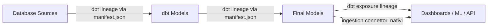

# Ingestion dbt → OpenMetadata: copertura lineage da source a exposure

## Risposta breve

**Sì, l'ingestion da dbt a OpenMetadata è possibile e copre un lineage molto esteso**, ma con un'importante precisazione: **le exposures dbt non sono ancora ufficialmente supportate** nella documentazione, anche se il codice per gestirle è presente nella codebase di OpenMetadata.

## Dettaglio

### 1. Lineage da source a modello (coperto)

OpenMetadata estrae lineage da dbt attraverso due meccanismi distinti, entrambi basati sul `manifest.json` [[dbt-lineage-ingestion]]:

- **`depends_on`** (affidabilità alta): legge le dipendenze dirette `ref()` e `source()` tra i nodi
- **`compiled_code` / `compiled_sql`** (affidabilità media): il lineage parser analizza il SQL compilato per estrarre tabelle source e target

Le **sources dbt** sono incluse nel `manifest.json` (sezione `sources`) e vengono regolarmente processate, quindi il lineage da source (es. tabelle raw del database) fino ai modelli dbt intermedi e finali è **pienamente coperto** [[dbt-integration]].

> **Nota sul `compiled_code`**: se questo campo manca nel `manifest.json`, il lineage basato su query parsing è **silenziosamente assente**. Per garantirlo, eseguire `dbt compile && dbt docs generate` prima dell'ingestion [[dbt-lineage-ingestion]].

### 2. Lineage da modello a exposure (parzialmente coperto, non ufficialmente supportato)

Le **dbt exposures** sono un tipo di nodo nel `manifest.json` che descrive asset a valle dei modelli (dashboard, applicazioni ML, API endpoint) [[dbt]].

**Stato attuale:**

| Fonte | Evidenza |
|---|---|
| **Documentazione ufficiale** v1.12.x e latest | La feature table elenca "dbt Exposures" **senza checkmark** (né ✅ né ❌), storicamente considerata "not yet supported" |
| **Codice sorgente** (`metadata.py`) | Presenti i metodi `add_dbt_exposure()`, `parse_exposure_node()`, `create_dbt_exposures_lineage()` e le costanti `REQUIRED_EXPOSURE_KEYS` e `ExposureTypeMap` |
| **GitHub Issue #12911** | Aperta da agosto 2023, spostata attraverso 4 release (1.4 → 1.7 → 1.10 → Jan 2026). Ad aprile 2026 spostata nel progetto **"Shipping"**, assegnata a `ulixius9` |

_Nota: il web search di Perplexity (giugno 2026) riporta che il supporto è attivo — ma le docs ufficiali non lo confermano ancora. Possibile che la feature sia stata rilasciata in una versione recentissima non ancora documentata, oppure che i search engine stiano anticipando lo stato dal codice sorgente._

### 3. Come funziona il codice per le exposures (già nella codebase)

Il meccanismo di ingestion delle exposures funziona così:

1. Il `manifest.json` viene letto includendo anche la sezione `exposures`
2. Per ogni nodo con `resource_type == "exposure"`, vengono validati i campi obbligatori: `name`, `meta`, `type`, `resource_type`, `sources`
3. `parse_exposure_node()` verifica che il tipo di exposure sia tra quelli mappati:
   - `dashboard` → entità OpenMetadata `Dashboard`
   - `ml` → entità `MlModel`
   - `application` → entità `APIEndpoint`
4. Richiede `meta.open_metadata_fqn` nella definizione YAML dell'exposure per collegarla all'entità OpenMetadata esistente
5. `create_dbt_exposures_lineage()` crea gli edge di lineage tra le tabelle upstream (modelli dbt) e l'entità exposure, con source `DbtLineage`

### 4. Come ottenere lineage completo source → exposure (workaround)

Per ottenere un lineage realmente completo da source a exposure in OpenMetadata, si possono combinare due approcci:

1. **Ingestion dbt** per il lineage source → modelli (già funzionante)
2. **Ingestion connettori nativi** (Looker, Tableau, PowerBI, ecc.) per il lineage modelli → dashboard, che OpenMetadata gestisce nativamente
3. In futuro, quando le exposures saranno ufficialmente supportate, il passo 2 sarà coperto anche dal solo manifest dbt

### 5. Riepilogo delle 10 categorie di metadati ingerite da dbt

| Categoria | Stato |
|---|---|
| dbt Queries | ✅ Supportato |
| dbt Lineage | ✅ Supportato |
| dbt Tags | ✅ Supportato |
| dbt Owner | ✅ Supportato |
| dbt Descriptions | ✅ Supportato |
| dbt Tests | ✅ Supportato |
| dbt Tiers | ✅ Supportato |
| dbt Glossary | ✅ Supportato |
| dbt Domain | ✅ Supportato |
| dbt Custom Properties | ✅ Supportato |
| dbt Exposures | ⚠️ In sviluppo (codice presente, docs non aggiornate) |

## Fonti consultate

- `wiki/concepts/dbt-integration.md` — Panoramica completa dell'integrazione
- `wiki/concepts/dbt-lineage-ingestion.md` — Meccanismi di estrazione lineage
- `wiki/entities/dbt.md` — Entità dbt e modelli di deployment
- `wiki/sources/dbt Workflow  OpenMetadata Data Build Tool Integration.md` — Documentazione ufficiale OpenMetadata v1.12.x
- `raw/sources/dbt Workflow  OpenMetadata Data Build Tool Integration.md` — Raw source con feature table
- `wiki/concepts/data-lineage.md` — Concetti di lineage in OpenMetadata
- GitHub Issue [#12911](https://github.com/open-metadata/OpenMetadata/issues/12911) — Tracking ufficiale delle exposures
- Codice sorgente `metadata.py` (branch main) — implementazione `add_dbt_exposure`, `create_dbt_exposures_lineage`
- Codice sorgente `constants.py` — `REQUIRED_EXPOSURE_KEYS`, `ExposureTypeMap`
